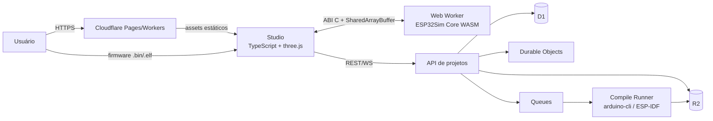
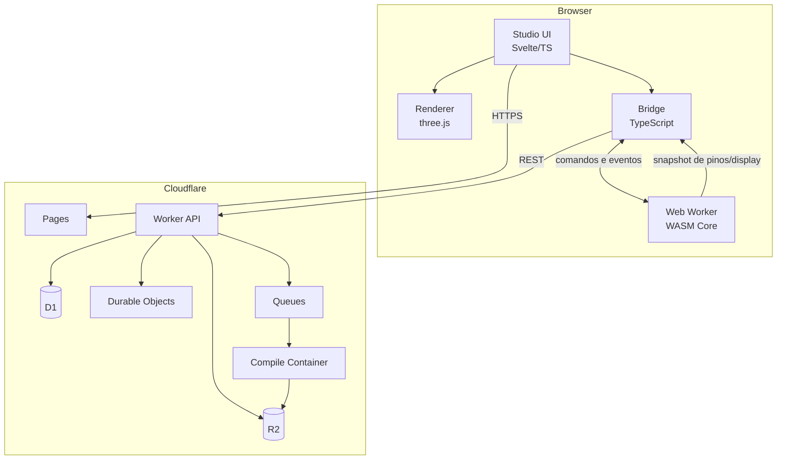
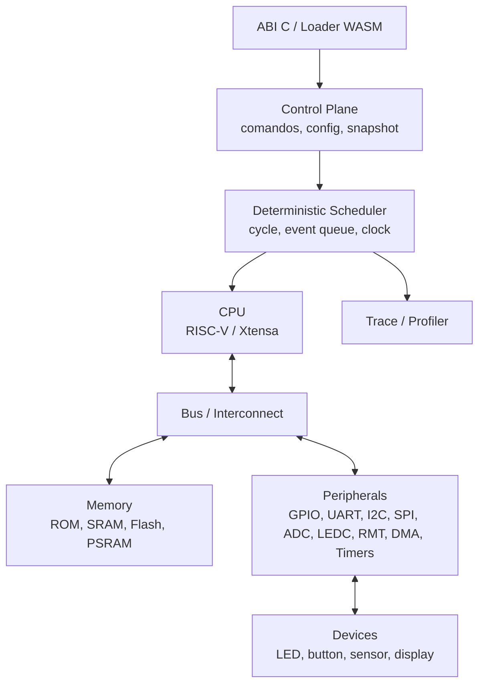

# 03 — Arquitetura

## 1. Decisões estruturantes

1. **O simulador é C++23.** CPU, SoC, periféricos, devices, scheduler,
   conectividade e tracing são C++.
2. **O core é compilado para WebAssembly** com Emscripten e executado em um
   Web Worker. O mesmo código é compilado nativamente para testes e CI.
3. **Three.js/TypeScript são somente apresentação.** Não há lógica de emulação,
   timing, GPIO ou periférico no frontend.
4. **ABI C estável e buffers compartilhados.** O hot path não usa JSON, Embind
   por ciclo ou chamadas JS por instrução.
5. **Determinismo por construção.** Scheduler de ciclos, RNG com seed e ordem
   total de eventos.
6. **Cloudflare hospeda o studio e as APIs.** Simulação roda no cliente;
   compilação de firmware roda em serviço separado.

## 2. Contexto



## 3. Containers



## 4. Core C++23

### 4.1 Camadas



Regras:

- `core/` não inclui headers de DOM, three.js, JSON, HTTP ou sistema
  operacional.
- `core/` não usa `std::chrono`, `std::random_device` ou `rand()`.
- `core/` recebe tempo apenas do scheduler.
- `core/` não aloca memória dinamicamente no caminho de instrução ou de acesso
  a registrador.
- O control plane pode alocar; o hot path usa arenas e buffers pré-alocados.

### 4.2 Scheduler determinístico

Modelo:

```text
while (running) {
  event = next_event()
  cpu.run_until(event.cycle)
  dispatch(event)
}
```

- Unidade base: ciclo de CPU do chip.
- Cada periférico declara eventos com `(deadline_cycle, priority, sequence)`.
- Empates são resolvidos por `priority` e, depois, por `sequence` monotônica.
- O scheduler nunca consulta o relógio de parede.
- O controle de velocidade (tempo real, 2x, pausado, passo) é feito **fora** do
  core, pelo bridge, convertendo ciclos em orçamento de frame.
- Modo batch: executar N ciclos o mais rápido possível, sem throttling.
- Modo determinístico de teste: mesma seed, mesmo trace, mesmo hash.

### 4.3 CPU

| Componente | MVP (C3) | V1 (S3) | V2 (clássico/C6) |
| --- | --- | --- | --- |
| ISA | RV32IMC | Xtensa LX7 | LX6 / RV32 + LP |
| Decode | Tabela + cache de blocos | Tabela + cache | Tabela + cache |
| Exceções | Sim | Sim | Sim |
| Interrupções | PLIC/CLINT | Interrupt matrix | PLIC/interrupt matrix |
| MMU/MPU | MPU | MMU | MMU/MPU |
| Contador | `mcycle`/`minstret` | CCOUNT | CCOUNT/mcycle |
| Debug | Trace/backtrace | GDB stub | GDB stub |

Implementação inicial:

- Interpretador C++23 com instruções pré-decodificadas.
- Sem JIT: WASM não permite gerar código executável em tempo real.
- Cache de tradução de blocos básicos para reduzir decode.
- Contabilidade de ciclos explícita por instrução.
- Testes de ISA gerados e comparados com QEMU.

### 4.4 Memória e barramentos

- Mapa de memória por chip, com regiões e permissões.
- ROM de boot, SRAM, flash mapeada, PSRAM, periféricos.
- Acesso via `Bus` com `read8/16/32`, `write8/16/32` e wait states.
- Flash cache e MMU configuráveis.
- `std::span<std::byte>` para buffers; sem cópias desnecessárias.
- Endianness explícita; `std::byteswap` quando necessário.

### 4.5 Periféricos

Interface conceitual:

```cpp
class Peripheral {
public:
  virtual ~Peripheral() = default;
  virtual std::expected<void, Error> reset() = 0;
  virtual uint32_t read(uint32_t offset, AccessSize size) = 0;
  virtual void write(uint32_t offset, uint32_t value, AccessSize size) = 0;
  virtual void tick(uint64_t cycle) = 0;
  virtual void raise_irq(IrqLine line) = 0;
};
```

- Registradores com semântica documentada (W1C, RO, RC, etc.).
- IRQs agregadas por matriz/PLIC.
- DMA com descriptors e arbitragem.
- Clock tree e resets por domínio.
- Cada periférico tem teste unitário e teste de integração com firmware.

### 4.6 Devices

Devices são modelos de componentes externos:

```cpp
class Device {
public:
  virtual void on_pin_change(PinId pin, bool level, uint64_t cycle) = 0;
  virtual void tick(uint64_t cycle) = 0;
  virtual DeviceState snapshot() const = 0;
};
```

- O core não conhece three.js; devolve estado agregado.
- O studio faz o mapeamento estado → geometria/material.
- Devices de tempo real (display, sensor) podem ter clocks próprios.
- Novos devices entram por registro e definição de placa.

### 4.7 Conectividade

Fase 3, mas a arquitetura já reserva:

- MAC/PHY virtual determinístico.
- Rede virtual com latência e perda configuráveis.
- lwIP ou pilha própria no firmware; o core fornece o link.
- HCI virtual para BLE.
- 802.15.4 para C6/H2.
- Captura PCAP para depuração.

Não colocar Wi-Fi no MVP: o custo de fidelidade é alto e desvia do núcleo.

## 5. ABI e bridge

### 5.1 Princípios

- ABI C, versão explícita, sem classes C++ na fronteira.
- Handles opacos.
- Structs com tamanho/versão para evolução.
- Comandos e eventos agregados; nada de JSON por ciclo.
- Memória compartilhada para snapshots e ring buffers.
- `postMessage` para controle de baixa frequência.

### 5.2 Superfície atual (ABI 0.1)

Implementada em `include/esp32sim/abi.h` e exercitada por `tests/test_abi.cpp`
(nativo) e `wasm/smoke.cjs` (WASM).

```c
#define ESP32SIM_ABI_VERSION_MAJOR 0
#define ESP32SIM_ABI_VERSION_MINOR 1
#define ESP32SIM_ABI_VERSION UINT32_C(0x0001)   /* major << 16 | minor */

typedef int32_t esp32sim_status;

typedef struct esp32sim_version {
  uint32_t major;
  uint32_t minor;
  uint32_t patch;
  uint32_t abi_version;
} esp32sim_version;   /* congelado em 16 bytes: nunca acrescentar campos */

typedef struct esp32sim_config {
  uint32_t struct_size;
  uint32_t flags;          /* reservado, deve ser 0 */
} esp32sim_config;

typedef struct esp32sim_handle esp32sim_handle;

uint32_t esp32sim_abi_version(void);
esp32sim_status esp32sim_get_version(esp32sim_version* out);
const char* esp32sim_version_string(void);

esp32sim_status esp32sim_create(const esp32sim_config* config,
                                esp32sim_handle** out_handle);
void esp32sim_destroy(esp32sim_handle* handle);
esp32sim_status esp32sim_run(esp32sim_handle* handle, uint64_t cycles);
uint64_t esp32sim_cycle_count(const esp32sim_handle* handle);

/* Ring de eventos (E0-05). Ver §5.3. */
esp32sim_status esp32sim_event_ring_init(esp32sim_handle* handle, uint32_t capacity);
esp32sim_event_ring* esp32sim_event_ring_header(esp32sim_handle* handle);
const esp32sim_event* esp32sim_event_ring_events(const esp32sim_handle* handle);
```

Regras:

- `config == NULL` usa defaults; `struct_size` menor que o conhecido ou
  `flags != 0` devolve `ESP32SIM_ERROR_INVALID_ARGUMENT`.
- `esp32sim_config` só evolui por acréscimo de campos ao final; o chamador
  informa seu próprio `struct_size`.
- `esp32sim_version` é congelado: sem `struct_size`, acrescentar um campo faria
  um core novo escrever além do buffer de um host antigo. Informação nova de
  identidade vai em função nova. O layout é verificado por `static_assert` em
  `core/src/abi.cpp`.
- `esp32sim_run` avança `cycles` e devolve `ESP32SIM_ERROR_STATE` em overflow,
  sem alterar o estado.
- Handle nulo é erro em toda função, exceto `esp32sim_cycle_count`, que devolve 0.
- Nenhuma exceção cruza a fronteira; erros são códigos estáveis.
- `esp32sim_event_ring_init` aceita só potência de 2 ≥ 2 (slot por máscara) e
  recusa a segunda chamada com `ESP32SIM_ERROR_STATE`.

Ainda não implementado (próximas fatias): `esp32sim_reset`, `esp32sim_set_pin`,
`esp32sim_read_serial`, `esp32sim_snapshot`, e os campos `chip_id`, `board_id`,
flash e PSRAM em `esp32sim_config` — que dependem da especificação do boot ROM
(E1-01).

- `snapshot` devolverá structs compactas de estado (pinos, displays, LEDs).
- Serial e eventos usam ring buffer em SharedArrayBuffer.
- Strings ficam no control plane, fora do hot path.
- Embind pode ser usado para conveniência, nunca no hot path.

O módulo WASM é autônomo (`-sSTANDALONE_WASM`): zero imports, sem glue JS e
exports com os mesmos nomes da ABI C. Ver [`BUILD.md`](../BUILD.md).

### 5.3 Protocolo de eventos

```text
Event {              /* 24 bytes, little-endian */
  uint32_t type;     /* offset 0  */
  uint32_t code;     /* offset 4  */
  uint64_t cycle;    /* offset 8  */
  uint64_t payload;  /* offset 16 */
}

RingHeader {         /* 16 bytes */
  uint32_t capacity; /* potência de 2, >= 2 */
  uint32_t head;     /* produtor: core  */
  uint32_t tail;     /* consumidor: host */
  uint32_t dropped;  /* produtor */
}
```

Tipos iniciais: `SERIAL_TX`, `PIN_CHANGE`, `IRQ`, `DEVICE_STATE`,
`TRACE_MARK`, `ERROR`, `STOPPED`, `BREAKPOINT` (valores 1 a 8 em `abi.h`).

Semântica inicial:

- `PIN_CHANGE`: `code` é o GPIO e `payload` bit 0 é o nível (0/1); os bits
  1..63 ficam reservados. `cycle` é o ciclo da mudança.

Regras do ring:

- SPSC: um produtor (core) e um consumidor (host). `head` e `tail` são
  contadores livres de 32 bits; o slot é `contador & (capacidade - 1)`.
- Toda leitura e escrita de `head`, `tail` e `dropped` é atômica:
  `std::atomic_ref` no C++ e `Atomics` no JS. Leitura simples pode rasgar.
- O produtor publica com release depois de escrever o evento; o consumidor lê
  `head` com acquire e avança `tail` depois de copiar os eventos.
- Ring cheio descarta o evento mais novo e incrementa `dropped`. O core nunca
  bloqueia por causa do host.
- O host drena uma vez por frame e agrega antes de tocar na UI; nenhum evento
  vira atualização de estado reativa (AP-02 do ADR 0007).

## 6. Threading e isolamento

### 6.1 MVP

- Um Web Worker executa o WASM single-thread.
- Main thread renderiza three.js e trata input.
- `SharedArrayBuffer` para estado de frame e serial.
- `postMessage` para comandos e eventos de controle.

### 6.2 Evolução

- Simulação dual-core **intercalada deterministicamente** em um único thread.
- Paralelismo real só para tarefas fora do core (decode de assets, compilação,
  análise).
- Se threads no core forem necessárias, usar lockstep com barreiras por ciclo
  e testes de determinismo. Não introduzir concorrência livre.

### 6.3 Requisitos de browser

- `SharedArrayBuffer` exige cross-origin isolation (COOP/COEP).
- Fallback sem threads: `postMessage` + buffers copiados; desempenho menor.
- Detectar suporte e escolher o build (`threads` vs `single`).

## 7. Studio (three.js + TypeScript)

### 7.1 Stack

- **Svelte 5 + Vite + TypeScript** (recomendado por continuidade com
  `LineFollower_Simulator`; React 19 é alternativa local ao studio e exige ADR).
- three.js isolado em `apps/studio/src/render/`.
- Estado do projeto em stores; estado da simulação vem do worker.
- Sem lógica de emulação em Svelte/TS.

### 7.2 Camadas do studio

```text
UI (painéis, editor, menus)
  ↓
Store (projeto, seleção, comandos)
  ↓
Bridge (worker, ABI, eventos)
  ↓
Renderer (three.js: cena, materiais, picking)
```

### 7.3 Cena 3D

- Modelos de placa e componentes em glTF/GLB com metadados de pinos.
- Instancing para componentes repetidos.
- LOD para cenas grandes.
- Raycasting para seleção e conexão de fios.
- Fios como curvas/tubos ou linhas com espessura; atualização só quando muda.
- `CSS2DRenderer` para labels de pinos.
- Câmera orbital com limites; zoom sem clipping.
- Unidades em milímetros; origem no canto da placa.
- Orçamento: ≤ 300 draw calls e ≤ 500k triângulos no MVP.

### 7.4 Performance de render

- `requestAnimationFrame` só para render/interpolação.
- Simulação em worker; nunca bloquear o main thread.
- Atualizar materiais/instâncias apenas em mudanças de estado.
- Texturas e modelos cacheados; carregamento progressivo.
- `OffscreenCanvas` opcional para render em worker em telas grandes.

### 7.5 Acessibilidade

- Alternativa 2D/tabular para pinos e conexões.
- Navegação por teclado no editor.
- Contraste e foco visível.
- Monitor serial com `aria-live` controlado.

### 7.6 Padrões de apresentação

Normativos pelo [ADR 0007](adr/0007-padroes-de-apresentacao-do-studio.md):

| ID | Regra |
| --- | --- |
| AP-01 | Catálogo de painéis por ID, carga sob demanda, ID duplicado falha em teste |
| AP-02 | Estado de simulação fora da camada reativa; UI atualiza só em mudança discreta |
| AP-03 | Lógica de apresentação pura e testada, sem DOM e sem three.js |
| AP-04 | Contenção de erro em três níveis: rota, painel, desenho |
| AP-05 | i18n/RTL desde o primeiro commit; nenhuma string visível inline |
| AP-06 | Acessibilidade operacional: teclado, leitor de tela, `prefers-reduced-motion` |
| AP-07 | Cor sempre por token de tema; nunca literal em canvas ou componente |
| AP-08 | Analisador lógico e diagramas consomem trace do core, não animação |

## 8. Build C++23/WASM

### 8.1 Toolchain

- CMake ≥ 3.28, Ninja, Clang/LLVM recente.
- Emscripten estável pinado (versão exata em `cmake/toolchains`).
- `-std=c++23`.
- `-O3 -flto` no release; `-O2 -g` no perfil de debug.
- `-fno-exceptions -fno-rtti` no build WASM (salvo ADR).
- `-msimd128` quando suportado; fallback sem SIMD.
- `-pthread` apenas no build threaded; `-sSHARED_MEMORY=1`.
- `-sMODULARIZE=1 -sEXPORT_ES6=1 -sENVIRONMENT=web,worker`.
- `-sALLOW_MEMORY_GROWTH=1` com limite explícito.
- Sem `--preload-file` para assets grandes; usar R2/fetch.

### 8.2 Perfis

| Perfil | Uso | Flags |
| --- | --- | --- |
| `debug` | Desenvolvimento | `-O0 -g`, asserts, sanitizers nativos |
| `release` | Produção | `-O3 -flto`, sem asserts |
| `perf` | Benchmarks | `-O3 -g`, contadores, sem logs |
| `conformance` | Testes | `-O2 -g`, trace completo |

### 8.3 Build nativo

- Mesmo código, toolchain nativa (MSVC/Clang/GCC).
- Usado para testes rápidos, fuzzing, sanitizers e QEMU-side tools.
- `ctest` + `catch2`/`GoogleTest`.
- CI roda nativo e WASM; traces devem ser idênticos.

### 8.4 C++23

- Usar `std::expected` para erros no core.
- `std::span` para buffers.
- `std::bit_cast`, `std::byteswap`, `std::to_underlying`.
- `if consteval` para código compile-time.
- Evitar `std::print`/`iostream` no core; logging via callback.
- Modules C++23 são opcionais; headers primeiro para compatibilidade com
  Emscripten e ferramentas.
- Sem exceções: erros são valores; falhas fatais usam `std::abort` controlado
  ou callback de erro.

## 9. Estrutura do repositório

```text
ESP32Sim/
  CMakeLists.txt
  CMakePresets.json
  cmake/
    toolchains/
      emscripten.cmake
      native.cmake
  core/
    include/esp32sim/core/...
    src/
      cpu/riscv/
      cpu/xtensa/
      soc/
      peripherals/
      devices/
      scheduler/
      memory/
      trace/
  include/esp32sim/
    abi.h
    config.h
    events.h
  wasm/
    bindings.cpp
    loader.ts
    worker.ts
  apps/studio/
    index.html
    src/
      main.ts
      App.svelte
      domain/          # lógica de apresentação pura (AP-03)
      bridge/          # worker, ABI e drenagem do ring (AP-02)
      panels/          # catálogo de painéis por ID (AP-01)
      render/          # three.js isolado
      i18n/            # catálogos pt-BR/en (AP-05)
      theme/           # tokens de cor (AP-07)
  services/compiler/
  tests/
    unit/
    integration/
    conformance/
    golden/
  tools/
    gen/
    bench/
  docs/
  evidence/
  provenance/
```

## 10. Modelo de projeto

O projeto é um JSON versionado (fora do core) com:

```json
{
  "schemaVersion": 1,
  "name": "blink-c3",
  "board": "c3-devkit-v1",
  "chip": "esp32-c3",
  "sketch": { "files": { "sketch.ino": "..." } },
  "firmware": { "kind": "bin", "assetId": "..." },
  "parts": [
    { "id": "led1", "type": "led", "pins": { "A": "GPIO8" }, "position": [0, 0, 0] }
  ],
  "wires": [
    { "from": "led1.A", "to": "board.GPIO8", "color": "wire.red" }
  ],
  "simulation": {
    "seed": 42,
    "speed": 1.0,
    "trace": false
  },
  "view": {
    "camera": { "position": [0, 120, 160], "target": [0, 0, 0] }
  }
}
```

Regras:

- Migrações explícitas por `schemaVersion`.
- `board` é o id interno e versionado do produto (ADR 0006), não o id de um
  terceiro; nomes de placas da Espressif aparecem só como compatibilidade.
- `color` referencia um token de tema (`wire.*`), nunca um literal (AP-07).
- O core recebe uma representação binária compacta, não o JSON.
- O JSON nunca entra no hot path.
- Assets referenciados por ID/content hash, armazenados em R2/local.
- Nenhum asset proprietário embutido sem licença.

## 11. Orçamentos de desempenho

| Item | MVP | V1 |
| --- | --- | --- |
| Ciclos simulados/s | ≥ 80M | ≥ 240M |
| Tempo de CPU por frame (16,6 ms) | ≤ 10 ms | ≤ 12 ms |
| Render | ≤ 5 ms | ≤ 5 ms |
| Eventos por frame | ≤ 2.000 | ≤ 5.000 |
| Chamadas JS por frame | ≤ 20 | ≤ 20 |
| Memória WASM | ≤ 256 MB | ≤ 512 MB |
| Tamanho WASM gzip | ≤ 8 MB | ≤ 15 MB |

Os números são metas, não promessas. Cada release mede e publica.

## 12. Erros, logging e tracing

- `std::expected<T, Error>` no core.
- `Error` é um código + contexto compacto, sem alocação no hot path.
- Logs do core vão para um ring buffer; a UI decide o que mostrar.
- Trace é opcional e compilado por perfil (`conformance`).
- Trace não deve alterar o timing quando desligado.
- Falhas de firmware (panic, watchdog) geram evento, não exceção.

## 13. Segurança

- Firmware é tratado como não confiável: validação de imagem, limites de
  memória e timeouts.
- O WASM roda em worker isolado; sem acesso direto ao DOM.
- CSP estrita; sem `eval`; sem scripts de terceiros não auditados.
- Projetos compartilhados passam por validação de schema e limites.
- Segredos ficam em Workers/Secrets, nunca no bundle.
- Uploads têm limite de tamanho e tipo; antivírus/quarentena no backend.

## 14. Observabilidade

- Métricas do core: ciclos, instruções, eventos, IRQs, DMA, stalls.
- Métricas do worker: tempo de execução, mensagens, memória.
- Métricas do render: fps, draw calls, triângulos, texturas.
- Métricas de produto: tempo até blink, erros de build, retenção.
- OpenTelemetry no Worker; logs estruturados.

## 15. ADRs relacionados

- [`adr/0001-core-cpp23-wasm.md`](adr/0001-core-cpp23-wasm.md)
- [`adr/0002-prioridade-de-chips.md`](adr/0002-prioridade-de-chips.md)
- [`adr/0003-topologia-cloudflare.md`](adr/0003-topologia-cloudflare.md)
- [`adr/0004-threading-e-isolamento.md`](adr/0004-threading-e-isolamento.md)
- [`adr/0005-escopo-de-paridade-do-mvp.md`](adr/0005-escopo-de-paridade-do-mvp.md)
- [`adr/0006-identidade-e-defaults.md`](adr/0006-identidade-e-defaults.md)
- [`adr/0007-padroes-de-apresentacao-do-studio.md`](adr/0007-padroes-de-apresentacao-do-studio.md)
