# 04 — Plano de trabalho

## 1. Premissas de planejamento

- Estimativas em **semanas de engenheiro**, não em datas de calendário.
- Base: 1–2 engenheiros humanos + agentes de IA; se o time for menor, as fases
  alongam, não encolhem o escopo.
- O escopo pode ser cortado, mas os gates de qualidade não.
- Cada fase termina com demo, trace dourado, documentação e ADRs atualizados.
- Nenhuma fase começa com dívida de licença em aberto.

## 2. Visão geral das fases

| Fase | Foco | Duração estimada | Gate |
| --- | --- | --- | --- |
| 0 | Descoberta, licenças, spikes e decisões | 2–3 semanas | G0 |
| 1 | ESP32-C3 + boot + GPIO/UART/timer + studio + deploy | 8–12 semanas | G1 |
| 2 | ESP32-S3 + periféricos + GDB + analisador lógico | 10–14 semanas | G2 |
| 3 | Wi-Fi/BLE/802.15.4 + dual-core + C6 | 12–16 semanas | G3 |
| 4 | ESP32 clássico, P4, colaboração, custom chips | contínuo | G4 |

```mermaid
gantt
  title ESP32Sim — fases (semanas de engenheiro)
  dateFormat  X
  axisFormat  %s
  section Fase 0
  Descoberta e decisões        :f0, 0, 3
  section Fase 1
  C3 core + SoC mínimo         :f1a, after f0, 6
  Studio + deploy              :f1b, after f0, 4
  Conformidade MVP             :f1c, after f1a, 3
  section Fase 2
  S3 + periféricos             :f2a, after f1c, 8
  Debug + analisador           :f2b, after f2a, 4
  section Fase 3
  Conectividade + C6           :f3, after f2b, 12
```



## 3. Fase 0 — Descoberta e fundação (G0)

### Objetivos

1. Validar a viabilidade técnica do core C++23→WASM.
2. Validar a ponte com three.js e o deployment na Cloudflare.
3. Concluir a avaliação do REA e a revisão de licenças.
4. Fixar escopo do MVP e arquitetura.

### Entregáveis

- [ ] `01-avaliacao-rea.md` revisado com evidências reais.
- [ ] Revisão de ToS/EULA do Wokwi e das licenças de QEMU/Velxio/Arduino.
- [x] Spike: CMake + Emscripten + C++23 + Web Worker + `SharedArrayBuffer`
  (E0-03..05; `ctest --preset wasm` roda `wasm_smoke` e `worker_smoke`).
- [x] Spike: three.js carrega board glTF e atualiza LED por evento do worker
  (E0-06; `npm test` em `apps/studio`, board em `tools/gen/`).
- [ ] Spike: Cloudflare Pages/Workers com COOP/COEP e WASM.
- [ ] Benchmark: ciclos/s, memória, tamanho, tempo de carga.
- [ ] ADRs 0001–0004 aceitos.
- [x] ADRs 0005 (paridade) e 0006 (identidade) propostos, revisados e aceitos.
- [x] ADR 0007 (padrões de apresentação do studio) proposto, revisado e aceito.
- [ ] Backlog da Fase 1 refinado e estimado.
- [ ] Riscos priorizados e donos definidos.

### Tarefas

| ID | Tarefa | Dono | Depende |
| --- | --- | --- | --- |
| E0-01 | Atualizar Node para 22.x ≥ 22.19, 24.x ≥ 24.11 ou 26+ e validar REA | platform | — |
| E0-02 | Revisar termos/licenças e registrar parecer | clean-room | — |
| E0-03 | Criar esqueleto CMake C++23 + presets | wasm-toolchain | — |
| E0-04 | Build WASM “hello core” com ABI C | wasm-toolchain | E0-03 |
| E0-05 | Worker + SAB + ring buffer de eventos | wasm-toolchain | E0-04 |
| E0-06 | Cena three.js + board glTF + LED | web3d | E0-05 |
| E0-07 | Deploy Pages/Workers com COOP/COEP | cloudflare | E0-04 |
| E0-08 | Benchmark e relatório de desempenho | verification | E0-04 |
| E0-09 | ADR 0001 (C++23/WASM) | lead | E0-03..08 |
| E0-10 | ADR 0002 (ordem de chips) | lead | E0-02 |
| E0-11 | ADR 0003 (Cloudflare) | cloudflare | E0-07 |
| E0-12 | ADR 0004 (threading) | wasm-toolchain | E0-05 |
| E0-13 | Evidence log do Wokwi (se permitido) | rea-evidence | E0-02 |
| E0-14 | Especificação do MVP C3 | lead | E0-09..12 |
| E0-15 | ADRs 0005 (paridade) e 0006 (identidade) | lead | E0-14 |
| E0-16 | ADR 0007 (padrões de apresentação do studio) | lead, web3d | E0-05 |

### Gate G0

- Build WASM reproduzível em CI.
- three.js exibe estado vindo do core sem lógica de simulação no frontend.
- Deploy acessível com headers corretos.
- Nenhuma licença bloqueante em aberto.
- Escopo do MVP assinado.

## 4. Fase 1 — MVP ESP32-C3 (G1)

### Objetivos

- Executar firmware Arduino real no navegador.
- Demonstrar GPIO, UART, timer, interrupções e flash.
- Ter um studio 3D utilizável e um projeto compartilhável.
- Estabelecer a suíte de conformidade e o pipeline de release.

### Épicos e histórias

#### E1-01 — Núcleo RV32IMC

- Decoder e executor de RV32IMC.
- Contador de ciclos, `mcycle`, `minstret`.
- Exceções e interrupções básicas.
- Testes de ISA (riscv-tests + testes próprios).
- Trace de registradores e memória.

**Aceite:** firmware bare-metal de soma/loop e `riscv-tests` selecionados passam;
trace idêntico nativo/WASM.

#### E1-02 — SoC mínimo C3

- Mapa de memória, ROM de boot, SRAM, flash.
- GPIO + IO MUX + matrix.
- UART0 com FIFO, baud, IRQ.
- Timers de sistema e watchdog básico.
- Reset, clock tree mínimo, eFuse stub.
- PLIC/CLINT.

**Aceite:** `Blink` e `Serial` do Arduino core rodam; GPIO e UART têm testes
unitários e de integração.

#### E1-03 — Boot e flash

- Imagem de flash, partições, bootloader.
- Carregamento de ELF para símbolos.
- Upload de `.bin` e `.elf`.
- Validação de imagem e limites.

**Aceite:** firmware compilado para C3 boota sem patches.

#### E1-04 — Scheduler e runtime

- Scheduler determinístico.
- Event queue e IRQ dispatch.
- FreeRTOS básico (tarefas, ticks, filas).
- Timeouts e panic handler.

**Aceite:** exemplo FreeRTOS com duas tarefas e serial.

#### E1-05 — ABI/WASM

- ABI C versionada.
- Worker, SAB, ring buffers.
- Build threaded e single-thread.
- Detecção de capability no browser.

**Aceite:** 60 fps de UI com firmware rodando; sem chamadas JS por ciclo.

#### E1-06 — Studio 3D

- Board C3 DevKitM-1 em glTF.
- LED, botão e buzzer (potenciômetro no V1, com ADC).
- Editor de fios e pinos.
- Monitor serial e controles de execução.
- Salvar/abrir/compartilhar projeto.

**Aceite:** usuário monta blink com LED externo e compartilha URL.

#### E1-07 — Conformidade MVP

- Golden traces de `Blink`, `Serial`, `Timer`, `GPIO`.
- Testes nativo + WASM.
- Benchmark de ciclos e frame.
- CI com cache e artefatos.

**Aceite:** 100% dos goldens passam; performance dentro do orçamento.

#### E1-08 — Deploy

- Cloudflare Pages + Worker.
- Headers COOP/COEP/CSP.
- R2 para assets, D1 para projetos.
- Métricas e alertas mínimos.

**Aceite:** deploy público, rollback e monitoração.

### Gate G1

- Demo pública de blink e serial.
- Trace dourado verde em nativo e WASM.
- Nenhum crash conhecido de boot.
- Documentação de limitações.
- Custo Cloudflare dentro do orçamento.

## 5. Fase 2 — ESP32-S3 e periféricos (G2)

### Objetivos

- Segundo chip (Xtensa LX7 dual-core).
- Periféricos de uso real: I2C, SPI, ADC, LEDC, RMT, DMA.
- Depuração GDB e analisador lógico.
- Testes diferenciais contra QEMU.

### Épicos

| ID | Épico | Aceite |
| --- | --- | --- |
| E2-01 | Núcleo Xtensa LX7 | ISA, IRQ, MMU e dual-core intercalado |
| E2-02 | SoC S3 | Memória, USB Serial/JTAG, PSRAM |
| E2-03 | I2C/SPI | Sensores e displays virtuais |
| E2-04 | ADC/LEDC | Leitura e PWM com timing |
| E2-05 | RMT/DMA | NeoPixel e transfers |
| E2-06 | GDB stub | Breakpoints, step, backtrace, watchpoints |
| E2-07 | Analisador lógico | Waveform de pinos e UART/I2C/SPI decode |
| E2-08 | Conformidade diferencial | ≥ 10 firmwares vs QEMU |
| E2-09 | Exemplos oficiais | Arduino/IDF no escopo passam |

### Gate G2

- S3 dual-core com FreeRTOS SMP.
- I2C/SPI/ADC/PWM/RMT validados.
- GDB funcional no studio.
- Nenhuma regressão nos goldens do C3.
- Relatório de divergências vs QEMU com limitações.

## 6. Fase 3 — Conectividade e C6 (G3)

### Objetivos

- Wi-Fi station + TCP/UDP + HTTP local.
- BLE advertising/GATT básico.
- 802.15.4/Thread no C6/H2.
- Rede virtual determinística.
- Captura de pacotes.

### Épicos

| ID | Épico | Aceite |
| --- | --- | --- |
| E3-01 | Link Wi-Fi virtual | `WiFi.begin` + IP + ping |
| E3-02 | lwIP/pilha | HTTP server e client |
| E3-03 | BLE HCI | advertising e GATT básico |
| E3-04 | 802.15.4 | Thread/Zigbee mínimo |
| E3-05 | Rede determinística | latência/perda reproduzíveis |
| E3-06 | PCAP | captura no studio |
| E3-07 | C6/H2 | boot e periféricos principais |

### Gate G3

- Firmware com Wi-Fi + HTTP roda de ponta a ponta.
- BLE básico funciona.
- Testes de estresse sem deadlock.
- Determinismo mantido com rede ativa.

## 7. Fase 4 — Produto e ecossistema

- ESP32 clássico (LX6) e P4.
- Colaboração em tempo real (Durable Objects + CRDT).
- Custom chips/plugins.
- Marketplace de componentes e placas.
- Templates educacionais.
- Contas, times, quotas e faturamento.
- Certificação de compatibilidade.

## 8. Workstreams e donos

| Workstream | Dono | Apoio |
| --- | --- | --- |
| Arquitetura e roadmap | `esp32-lead` | todos |
| Evidência e compatibilidade | `rea-evidence` | clean-room |
| Licenças e proveniência | `clean-room-auditor` | lead |
| CPU/ISA/scheduler | `cpp-core-engineer` | verification |
| SoC/periféricos | `soc-peripherals-engineer` | cpp-core |
| Firmware/boot/debug | `firmware-runtime-engineer` | cpp-core |
| Build WASM/toolchain | `wasm-toolchain-engineer` | cpp-core |
| Studio/three.js | `web3d-engineer` | cloudflare |
| Cloudflare/compilador | `cloudflare-platform-engineer` | wasm-toolchain |
| Conformidade/benchmarks | `verification-engineer` | todos |
| Wi-Fi/BLE/802.15.4 | `connectivity-engineer` | soc |

## 9. Cadência

- **Diário:** tarefa atual, bloqueios, evidência do dia.
- **Semanal:** demo, revisão de traces, riscos, atualização do backlog.
- **Por milestone:** gate formal, relatório de desempenho, ADRs.
- **Por release:** changelog, limitações conhecidas, SBOM, licenças.

## 10. Definição de pronto (DoD)

Uma tarefa só termina quando:

1. Código compila nativo e WASM.
2. Testes unitários e de integração passam.
3. Trace dourado atualizado (se comportamento mudou).
4. Documentação/ADR atualizados.
5. Nenhuma licença nova sem revisão.
6. Performance medida e dentro do orçamento.
7. Evidência registrada em `evidence/`.
8. Revisão de código por outro agente/humano.

## 11. Primeiras 10 tarefas concretas

1. Atualizar Node.js para 22.x ≥ 22.19, 24.x ≥ 24.11 ou 26+ e rodar `rea doctor`.
2. Revisar ToS do Wokwi e licenças de QEMU/Velxio/Arduino.
3. Criar `CMakeLists.txt`, presets e toolchain Emscripten.
4. Compilar um core C++23 mínimo para WASM e rodar em Web Worker.
5. Implementar ABI C v1 e ring buffer de eventos.
6. Implementar RV32IMC básico (ADD/SUB/LW/SW/BEQ/JAL) com testes.
7. Implementar mapa de memória e UART mínima do C3.
8. Fazer um firmware bare-metal “hello” rodar no core.
9. Criar cena three.js com board C3 e LED reagindo ao core.
10. Publicar um preview na Cloudflare com COOP/COEP.

## 12. Caminho crítico

```text
C++23→WASM → ABI/worker → RV32IMC → SoC mínimo → boot Arduino
   → golden traces → studio 3D → deploy → S3/periféricos
```

A conectividade não está no caminho crítico do MVP. Qualquer trabalho nela
antes do G1 é uma aposta que deve ser justificada.
