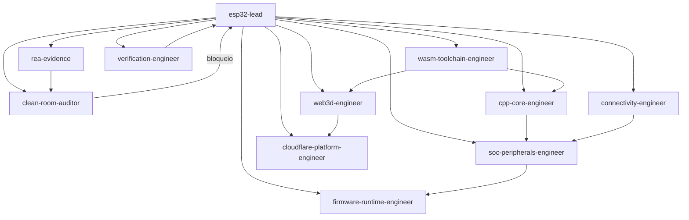

# 05 — Agentes e protocolo de trabalho

## 1. Princípio

Os agentes existem para **reduzir o contexto necessário por tarefa** e manter
especialização com handoffs explícitos. O `esp32-lead` orquestra; os demais
executam trabalho delimitado e devolvem evidência, não opinião.

Regras:

1. Quem implementa não é quem valida a evidência de origem.
2. Quem coleta evidência não implementa o comportamento correspondente.
3. Toda conclusão precisa de fonte, teste ou trace.
4. O lead não aceita “parece que funciona” como critério de pronto.
5. Nenhum agente copia código/assets proprietários para o repositório.

## 2. Elenco

| Agente | Modo | Missão | Entregáveis | Não faz |
| --- | --- | --- | --- | --- |
| `esp32-lead` | primary | Orquestrar escopo, arquitetura, prioridades e gates | ADRs, plano, decisões, revisão de milestone | Implementar tudo sozinho |
| `rea-evidence` | subagent | Coletar evidência de interoperabilidade com REA | Evidências, specs comportamentais, mapas de contrato | Copiar código/assets; implementar features |
| `clean-room-auditor` | subagent | Auditar proveniência, licenças e separação clean-room | Pareceres, bloqueios, checklist de licença | Escrever código de produção |
| `cpp-core-engineer` | subagent | CPU, ISA, scheduler, memória, ABI e tracing | C++23 do core, testes de ISA, traces | UI, cloud, compilador de firmware |
| `soc-peripherals-engineer` | subagent | SoC, GPIO, UART, I2C, SPI, ADC, LEDC, RMT, DMA, timers | Periféricos C++23 + testes | CPU/ISA, three.js |
| `firmware-runtime-engineer` | subagent | Boot, flash, FreeRTOS, ELF, GDB, serial | Runtime C++23 + integração de firmware | Periféricos de UI, deploy |
| `wasm-toolchain-engineer` | subagent | CMake/Emscripten, ABI WASM, threads, SIMD, profiling | Builds, loader, worker, benchmarks | Lógica de emulação |
| `web3d-engineer` | subagent | Studio TypeScript + three.js, editor, cena, painéis | UI, renderer, bridge, acessibilidade | Emulação/timing |
| `cloudflare-platform-engineer` | subagent | Pages/Workers/R2/D1/DO/Queues/Containers, CI/CD, custos | Infra, APIs, deploy, segurança | Emulação, render |
| `verification-engineer` | subagent | Conformidade, goldens, fuzzing, benchmarks, CI | Suíte de testes, relatórios, gates | Implementar features |
| `connectivity-engineer` | subagent | Wi-Fi/BLE/802.15.4, lwIP/SLIRP, HCI, rede virtual | Modelos de conectividade + testes | CPU/periféricos gerais |

## 3. Fluxo de orquestração



### Fluxo típico de uma feature de periférico

1. `esp32-lead` escreve o brief e define o critério de aceite.
2. `rea-evidence` (se aplicável) ou fontes públicas produzem a spec.
3. `clean-room-auditor` revisa a spec e a proveniência.
4. `soc-peripherals-engineer` implementa e testa.
5. `firmware-runtime-engineer` integra com firmware real.
6. `verification-engineer` adiciona golden trace e benchmark.
7. `esp32-lead` aceita ou devolve com perguntas.

## 4. Brief de tarefa

Todo handoff deve usar este formato:

```markdown
## Objetivo
Uma frase verificável.

## Contexto
Links para docs, ADRs, evidências e código relevante.

## Escopo
O que entra e o que não entra.

## Critério de aceite
- [ ] Teste X passa
- [ ] Trace Y idêntico
- [ ] Performance Z dentro do orçamento

## Restrições
Licenças, compatibilidade, prazo, APIs que não podem mudar.

## Evidência esperada
Comandos, arquivos, hashes, screenshots ou traces.

## Perguntas abertas
O que ainda não se sabe.
```

## 5. Protocolo de evidência

- Toda observação vira uma ficha em `evidence/<AAAA-MM-DD>/<tema>/README.md`.
- O JSON bruto fica ao lado, com SHA-256.
- Distinguir **observado**, **derivado**, **inferido** e **desconhecido**.
- Registrar ferramenta, versão, comando, origem e limitações.
- Não incluir tokens, cookies, headers de autorização ou dados pessoais.
- Uma spec só pode citar evidência registrada; não pode citar “o site”.
- Evidência de comportamento não autoriza copiar implementação.

Template completo em [`../evidence/README.md`](../evidence/README.md).

## 6. Contratos entre agentes

### `rea-evidence` → `clean-room-auditor` / lead

Entrega:

- pergunta respondida;
- evidências com IDs e hashes;
- nível de confiança e limitações;
- implicações de licença/ToS;
- recomendação de próximos testes.

Não entrega código pronto para copiar.

### `clean-room-auditor` → lead

Entrega:

- classificação `clean`, `needs-attribution`, `needs-decision`, `blocked` ou `unknown`;
- arquivos/dependências afetados;
- obrigações de licença;
- ação necessária (bloquear, substituir, documentar).

### `cpp-core-engineer` → `soc` / `firmware` / `verification`

Entrega:

- interface estável documentada;
- testes de ISA/scheduler;
- trace de referência;
- limitações conhecidas.

### `soc-peripherals-engineer` → `firmware` / `verification`

Entrega:

- mapa de registradores e IRQs;
- testes unitários e de integração;
- firmware de exemplo;
- comportamento documentado.

### `firmware-runtime-engineer` → `verification`

Entrega:

- imagem de teste;
- comandos de boot;
- saída serial esperada;
- símbolos e endereços.

### `wasm-toolchain-engineer` → `web3d` / `cloudflare`

Entrega:

- artefatos versionados (`esp32sim.wasm`, loader, worker);
- ABI e limites;
- instruções de build e deploy;
- benchmark.

### `web3d-engineer` → lead / verification

Entrega:

- build do studio;
- screenshot/vídeo do fluxo;
- métricas de render;
- lista de eventos consumidos do core.

### `cloudflare-platform-engineer` → lead

Entrega:

- URL de preview;
- headers e configuração;
- custos/limites;
- runbook de rollback.

### `verification-engineer` → lead

Entrega:

- relatório de conformidade;
- goldens e hashes;
- benchmark antes/depois;
- bloqueios e riscos.

## 7. Invocação no OpenCode

- O agente principal é `esp32-lead`; use `Tab` para trocar de agente.
- Para delegar, mencione o subagente ou use a ferramenta de task.
- Exemplos:

```text
@rea-evidence mapeie o formato de projeto observável do Wokwi e registre a evidência.
@cpp-core-engineer implemente RV32IMC ADD/SUB/LW/SW com testes e trace.
@verification-engineer adicione um golden trace do Blink para C3.
@clean-room-auditor revise as dependências e assets adicionados neste diff.
```

## 8. Permissões

- Implementadores: podem editar e rodar build/testes.
- `rea-evidence`: edita apenas `ESP32Sim/evidence/` e docs de evidência.
- `clean-room-auditor`: somente leitura; devolve parecer.
- `esp32-lead`: edita docs/ADRs e pode intervir no código para desbloquear.
- Nenhum agente pode commitar, fazer push ou criar PR sem pedido explícito.

## 9. Anti-padrões

- Delegar “implemente o emulador” sem critério de aceite.
- Aceitar captura de tela como prova de comportamento de registrador.
- Misturar código observado com implementação “inspirada”.
- Colocar lógica de timing no TypeScript.
- Usar JSON no hot path.
- Otimizar antes de medir.
- Declarar compatibilidade sem rodar o firmware de referência.
- Ignorar licença de asset/modelo 3D.

## 10. Definição de pronto do agente

Um agente só devolve “concluído” quando:

1. O critério de aceite foi verificado.
2. Os comandos e resultados estão no handoff.
3. As limitações estão explícitas.
4. Não há licença nova sem revisão.
5. O lead consegue reproduzir o resultado.
