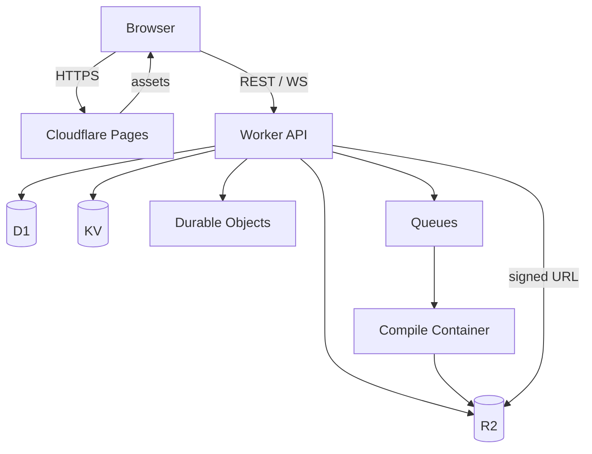

# 07 — Plataforma Cloudflare

## 1. Princípio

A Cloudflare hospeda **conteúdo estático, APIs e o serviço de compilação**. A
simulação roda no navegador do usuário, em WebAssembly. Isso mantém o custo
previsível, a latência baixa e o core sob controle do usuário.

```text
Cloudflare Pages  → studio estático (HTML/JS/WASM/assets)
Cloudflare Workers → API de projetos, auth, quotas, shares
R2                → assets, firmwares, artefatos de build
D1                → metadados de usuários/projetos
KV                → cache de shares, feature flags
Durable Objects   → colaboração/sessões em tempo real (Fase 4)
Queues            → jobs de compilação
Containers        → toolchain arduino-cli/ESP-IDF (quando disponível)
```

## 2. Topologia



## 3. Componentes

### 3.1 Pages

- Build do studio (`vite build`).
- WASM, loader, worker e assets com hash no nome.
- Headers:
  - `Cross-Origin-Opener-Policy: same-origin`
  - `Cross-Origin-Embedder-Policy: require-corp`
  - `Cross-Origin-Resource-Policy: same-origin`
  - `Content-Security-Policy` estrita.
  - `Cache-Control` imutável para assets com hash; `no-cache` para HTML.
- Preview deployments por branch/PR.

> COOP/COEP são necessários para `SharedArrayBuffer` e threads. Testar o
> fallback single-thread em browsers que bloqueiam isolamento.

### 3.2 Worker API

Responsabilidades:

- autenticação (GitHub OAuth ou e-mail mágico).
- CRUD de projetos e metadados.
- URLs assinadas para R2.
- quotas, rate limit e moderação.
- compartilhamento por slug/URL.
- orquestração de compilação.
- telemetria e feature flags.

Sugestão: TypeScript + Hono (leve, compatível com Workers). Evitar frameworks
pesados.

### 3.3 D1

Tabelas iniciais:

```sql
CREATE TABLE users (
  id TEXT PRIMARY KEY,
  provider TEXT NOT NULL,
  provider_id TEXT NOT NULL,
  display_name TEXT,
  created_at TEXT NOT NULL,
  UNIQUE(provider, provider_id)
);

CREATE TABLE projects (
  id TEXT PRIMARY KEY,
  owner_id TEXT NOT NULL REFERENCES users(id),
  title TEXT NOT NULL,
  schema_version INTEGER NOT NULL,
  visibility TEXT NOT NULL DEFAULT 'private',
  r2_key TEXT NOT NULL,
  created_at TEXT NOT NULL,
  updated_at TEXT NOT NULL
);

CREATE TABLE builds (
  id TEXT PRIMARY KEY,
  project_id TEXT NOT NULL REFERENCES projects(id),
  status TEXT NOT NULL,
  toolchain TEXT NOT NULL,
  artifact_r2_key TEXT,
  log_r2_key TEXT,
  created_at TEXT NOT NULL,
  finished_at TEXT
);

CREATE TABLE shares (
  slug TEXT PRIMARY KEY,
  project_id TEXT NOT NULL REFERENCES projects(id),
  expires_at TEXT,
  created_at TEXT NOT NULL
);
```

- Migrações versionadas em `services/api/migrations/`.
- Índices por `owner_id`, `updated_at`, `slug`.
- Limite de tamanho por projeto (ex.: 5 MB de JSON + 20 MB de assets).

### 3.4 R2

Layout de chaves:

```text
assets/boards/<board-id>/<hash>.glb
assets/parts/<part-id>/<hash>.glb
assets/textures/<hash>.png
projects/<project-id>/<version>.json
firmware/<project-id>/<build-id>.bin
firmware/<project-id>/<build-id>.elf
builds/<build-id>/log.txt
```

- Imutável por hash.
- URLs assinadas de curta duração.
- Lifecycle para builds antigos.
- Nunca armazenar segredos ou firmware proprietário sem licença.
- Recursos de R2 usados no studio precisam de CORS e
  `Cross-Origin-Resource-Policy` compatíveis com COEP; prefira mesma origem via
  Worker/proxy para evitar bloqueio.

### 3.5 KV

- Cache de shares públicos.
- Feature flags.
- Configuração de rollout.
- Não usar para dados transacionais.

### 3.6 Durable Objects

Fase 4:

- salas de colaboração (Yjs/CRDT).
- sessões de debug compartilhadas.
- presença e cursores.
- rate limit distribuído.

Não usar para simulação (CPU no cliente).

### 3.7 Queues + compilação

A compilação de ESP-IDF/Arduino é pesada e não cabe em um Worker. Opções:

| Opção | Prós | Contras | Recomendação |
| --- | --- | --- | --- |
| **A. Cloudflare Containers** | Integrado, escala, R2 nativo | Custo, cold start, limites | Beta |
| **B. Runner externo** (GitHub Actions/Fly/VPS) | Controle total, toolchain | Latência, operação | Fallback |
| **C. Compilação local + upload** | Zero custo de servidor, offline | Exige toolchain no usuário | MVP |
| **D. Compilar no browser** | Sem servidor | Inviável para IDF | Não |

**Decisão sugerida:** MVP aceita `.bin`/`.elf` pronto e oferece compilação
local documentada. Beta adiciona Container com `arduino-cli` + ESP-IDF. Runner
externo fica como contingência.

Fluxo:

```text
POST /builds → cria job (D1) → Queue → Container
  → baixa projeto de R2 → compila → sobe bin/elf/log para R2
  → atualiza D1 → cliente faz polling ou recebe WS
```

Limites:

- timeout de build (ex.: 180 s).
- tamanho máximo de fonte (ex.: 1 MB).
- 1 build concorrente por usuário; fila global.
- artefatos expiram em 30 dias (configurável).
- logs truncados; nunca expor paths internos.

### 3.8 Containers (quando disponível)

- Imagem pinada com `arduino-cli`, cores ESP32 e ESP-IDF.
- Sem rede de saída, exceto registry/cache interno.
- Filesystem efêmero; entrada/saída via R2.
- Sem segredos do usuário.
- Assinatura de artefatos e SBOM.
- Sandbox de firmware: validar imagem antes de servir.

## 4. Segurança

### 4.1 Headers

```text
Content-Security-Policy:
  default-src 'self';
  script-src 'self' 'wasm-unsafe-eval';
  style-src 'self' 'unsafe-inline';
  img-src 'self' data: blob:;
  connect-src 'self';
  worker-src 'self';
  frame-ancestors 'none';
  base-uri 'self';
  object-src 'none';
  form-action 'none';
```

- Implementado em `apps/studio/public/_headers` (E0-07).
- `connect-src 'self'` hoje; a origem da API entra junto com o Worker (E1-08).
- `worker-src 'self'` sem `blob:`: o Worker do core é um asset same-origin
  (`?url` do Vite), não um object URL. Revisar só se algum dia houver worker
  gerado em runtime.
- `wasm-unsafe-eval` é necessário para WebAssembly em alguns browsers; avaliar
  alternativas e documentar.
- Sem `unsafe-eval` para JS.
- Sem scripts de terceiros não auditados.

### 4.2 Auth e quotas

- OAuth GitHub (MVP) + sessão assinada em cookie `HttpOnly`, `Secure`,
  `SameSite=Lax`.
- Rate limit por IP/usuário no Worker.
- Quotas de storage e builds.
- Moderação de shares públicos.
- CSRF protection em mutações.
- Nunca logar tokens.

### 4.3 Uploads

- Validar tipo/tamanho.
- Rejeitar executáveis nativos.
- Firmware é dado, não código executado no servidor.
- Escanear metadados e limites de imagem.
- Quarentena para conteúdo suspeito.

### 4.4 Supply chain

- Dependências pinadas e auditadas.
- SBOM por release.
- Assinatura de artefatos (Sigstore/cosign) quando possível.
- Ações de CI pinadas por SHA.
- Sem `latest` em produção.

## 5. Performance e custo

### 5.1 Premissas

- Simulação no cliente: custo de CPU do provedor próximo de zero.
- Assets em R2 com cache de borda.
- API leve; D1 para metadados.
- Compilação é o único custo variável relevante.

### 5.2 Orçamento

| Item | Meta |
| --- | --- |
| Peso inicial do studio | ≤ 3 MB gzip (sem toolchain) |
| WASM gzip | ≤ 8 MB MVP |
| Requisições por sessão | ≤ 20 |
| Custo de storage por projeto | ≤ 25 MB |
| Custo de build | ≤ US$ 0,05 |
| p95 da API | ≤ 300 ms |

### 5.3 Limites conhecidos

- Workers têm CPU/memória limitados; não executar emulação neles.
- D1 tem limites de query/tamanho; não armazenar blobs.
- R2 é para objetos; não usar como banco.
- Containers têm cold start; UX deve mostrar fila/status.
- Egress e operações de R2 têm custo; cachear.

## 6. Ambientes

| Ambiente | Uso | Dados |
| --- | --- | --- |
| `local` | Desenvolvimento | D1/R2 locais (Wrangler) |
| `preview` | PRs | Dados sintéticos |
| `staging` | Validação | Cópia anonimizada |
| `prod` | Usuários | Dados reais |

- `wrangler.toml` por ambiente.
- Segredos via `wrangler secret` / dashboard.
- Nunca commitar `.dev.vars`.

## 7. Deploy e rollback

### 7.1 CI/CD

```text
push → lint/test → build studio → build WASM → deploy preview
tag → deploy staging → smoke test → deploy prod → smoke test
```

- GitHub Actions com cache de Emscripten e npm.
- Artefatos versionados.
- Deploy atômico; rollback por versão anterior.
- Migrações D1 compatíveis para trás.

### 7.2 Smoke tests

- Página carrega.
- WASM instancia.
- Worker responde.
- COOP/COEP presentes.
- Blink roda em menos de 10 s.
- Share público abre.
- Build de exemplo conclui.

## 8. Observabilidade

- Logs estruturados no Worker (`request_id`, `user_id` hash, `route`).
- Métricas: requests, erros, latência, builds, filas.
- Alertas: erro 5xx > 1%, fila > 10 min, build failure > 5%.
- Tracing de builds (OpenTelemetry) com IDs.
- Dashboard de custo por dia.
- Nunca logar firmware, tokens ou dados pessoais.

## 9. Backup e retenção

- D1: export diário para R2, retenção 30 dias.
- R2: versionamento/lifecycle; cópia semanal para bucket frio.
- Projetos: cópia em R2 e export local pelo usuário.
- Exclusão de conta: remoção em até 30 dias, com confirmação.
- Logs: retenção 30 dias.

## 10. Local development

```powershell
npm install
npm run dev            # studio
npm run dev:api        # wrangler dev
npm run build:wasm     # emcmake cmake + emmake
npm run test           # unitários
npm run test:e2e       # Playwright
```

Requisitos:

- Node pinado.
- Emscripten pinado.
- Wrangler autenticado.
- Chrome para testes.

## 11. Riscos de plataforma

| Risco | Mitigação |
| --- | --- |
| Limite de CPU do Worker | Simulação no cliente; API leve |
| Custo de compilação | Quotas, cache, builds locais |
| COOP/COEP quebra embed | Testar; fallback single-thread |
| Vendor lock-in | Abstrair storage/API; export aberto |
| D1 limits | Metadados apenas; R2 para blobs |
| Container indisponível | Runner externo de contingência |
| Ataque de upload | Validação, limites, quarentena |

## 12. Decisões pendentes

- OAuth apenas GitHub ou também e-mail?
- Compilação no MVP é local ou Container?
- Colaboração entra na Fase 4 ou é cortada?
- Qual domínio e marca pública?
- Qual política de retenção de firmware?
